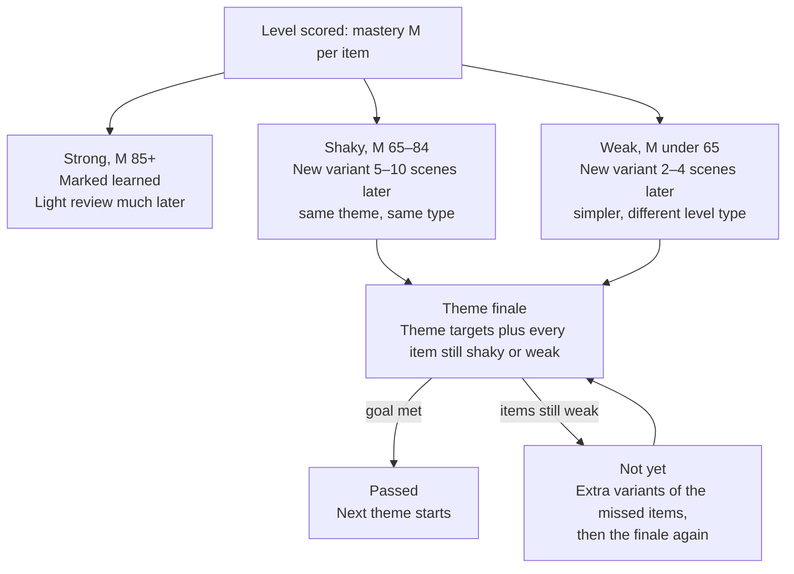

# Speaking Quest — Product Spec

Updated Oct 11, 2026 · "Speaking Quest" is a working name.

> Reference copy saved with the prototype. Visual references live in `docs/references/`.

## Overview

Speaking Quest is a speaking-first English app built like a hyper-casual game: one level at a time, each level a short spoken mission with one clear goal. The learner taps one big button, plays a 2–4 minute level, and only moves on once the goal is reached.

The aim is not grammar knowledge but natural use: thinking in English, answering without translating, and speaking with confidence in everyday situations.

**Core principles**

- **One next step.** The home screen shows the next scene in the current theme, a Play button and Free play. Theme choices live one tap away in My plan, never in the way.
- **One goal per level.** Every level shows a single goal ("Get your order remade"). Reaching it completes the level.
- **Speak, don't tap.** Every level type ends in the learner speaking, including listening levels.
- **Invisible personalization.** The learner just presses Play. Behind it, AI picks the next scene, difficulty, level type and review items for this learner.
- **Help is free, and counted.** Power-ups are unlimited. Their use shapes stars and decides what gets repeated later.
- **Soft failure.** No lives. A failed attempt shows the expressions that would have helped, then offers a retry.

**The loop**

1. Onboarding measures each skill and creates a learner profile.
2. AI builds a plan from the curriculum skeleton.
3. The learner plays the next level, using power-ups as needed.
4. The level is scored, stars and coins are awarded, new expressions are added to Expressions.
5. The scheduler decides what comes next, including re-queued weak items.

## Level types

There are six level types plus a boss level. Each one trains a different part of speaking, and every one ends with the learner talking.

| Type | Trains | What happens | Win condition | Rounds |
| --- | --- | --- | --- | --- |
| Conversation | Communicating in a situation | Role-play with an AI character who has a hidden need or obstacle | The AI judges the goal reached (e.g. order remade) | 1 scene, 4–8 turns |
| Listening | Understanding real speech | Learner hears a clip, then answers or asks a follow-up aloud | Correct spoken answer, or a relevant clarifying question | 1–3 clips |
| Think in English | Building sentences without translating | Describe a picture or scene; prompt chips (Who? Doing what? What next?) | Speaks a set number of connected sentences without long pauses | 1–2 scenes |
| Quick reply | Answering fast, no time to translate | Short questions with a 3–5 s timer; "a short answer is enough" | A relevant answer within the time on most rounds (e.g. 4 of 5) | 5 |
| Pronunciation | Stress, rhythm, clarity | Listen to a native line, repeat, compare waveforms | Intelligible with the target stress | 3–5 lines |
| Sound natural | Correct, natural phrasing | Fix a wrong or stiff sentence ("I am came to office") | A correct, natural version | 3–5 sentences |
| Boss (theme finale) | Retention across a theme | Unscripted conversation using the theme's targets plus shaky items | Goal reached and most target items used | 1 scene |

**Judging answers in Sound natural**

- **Wrong:** say why in one line, show the fix, ask the learner to say it.
- **Correct but stiff:** accept it, then show a more natural version as a bonus.
- **A valid variation:** accept and praise it. Never mark a correct answer wrong because it differs from the expected one.

**Power-ups per type (all unlimited)**

| Type | Power-ups |
| --- | --- |
| Conversation | Hint (first words of a good reply), Slower, Simplify, Translate |
| Listening | Replay, 0.75× speed, Show key word, Transcript |
| Think in English | Prompt chip, Starter words, Example sentence |
| Quick reply | Extra time (+3 s), Starter words, Skip |
| Pronunciation | Slow example, Syllable breakdown, Mouth tip |
| Sound natural | Highlight the error, Explain simply, Show answer |

Each power-up has a help weight used in scoring (see Scoring). Translate, Transcript and Show answer weigh the most.

## Onboarding

Onboarding is a 3–4 minute run of mini-levels, one round of each type, so it feels like playing rather than a test. It produces a skill profile that the plan is built from.

1. **Hello chat (60 s).** The AI asks about the learner's name, work and why they want English. This also measures vocabulary range and sentence complexity.
2. **Goals.** Learner picks what they need English for (work, travel, study, daily life) and how many minutes a day they want to play.
3. **Listening round.** One short clip, answered aloud.
4. **Quick reply round.** Three timed questions.
5. **Think in English round.** Describe one picture.
6. **Pronunciation round.** Repeat two lines.
7. **Sound natural round.** Fix two sentences.

Difficulty adapts during onboarding: a strong answer makes the next round harder, a weak one makes it easier. This finds the level in fewer rounds.

**Skill profile output**

| Skill | Measured by | Stored as |
| --- | --- | --- |
| Speaking range | Vocabulary and structures used in chat | Level band (A1–C1) |
| Listening | Listening round accuracy | Level band + preferred speed |
| Response speed | Seconds to start answering | Baseline latency (s) |
| Accuracy | Errors per sentence | Score 0–100 + list of recurring errors |
| Pronunciation | Intelligibility and stress | Score 0–100 + problem sounds |
| Goals and time | Learner's choices | Themes to prioritize, daily level count |

Each skill gets its own score because skills differ: someone can understand well but freeze when speaking. Baseline latency is stored per learner so later speed scoring compares them to themselves, not to a native speaker.

## Learning plan

The plan is a fixed curriculum skeleton that AI personalizes, not a plan the AI writes from scratch. This keeps quality consistent and stops the AI drifting or repeating itself.

**The skeleton (written by the team)**

- **Segments** are themes, e.g. "Café & food", "Work small talk", "Asking for help", "Making plans". Each is about 10–15 scenes and ends in a theme finale (boss).
- **Each segment lists target items:** expressions (chunks like "run late" and starters like "Could you remake it?"), sentence patterns ("I was going to… but…") and common errors to fix.
- **Each target item has a difficulty band** (A1–C1) and the level types that suit it.
- **Scenario templates** per segment: the setting, the AI character, the hidden obstacle, the goal.

**What AI personalizes**

| Decision | Based on |
| --- | --- |
| Which segments come first | Learner's goals from onboarding |
| Which target items inside a segment | Skill profile level band |
| Level type mix | Weakest skills get more of their type (e.g. slow responders get more Quick reply) |
| Scenario details | Learner's job, interests, country (from the hello chat) |
| Difficulty within a level | Recent mastery scores |
| Review items slipped into new levels | The scheduler (see Re-queue rules) |

**Generating a level**

The scheduler picks the next slot: a new level, a re-queued variant, or the finale. For a new level, the AI receives the template, target items, level type, difficulty and one or two due review items. It returns the level content (character, opening line, goal, success rubric). The content is checked against the rubric format before it is shown.

The plan is re-evaluated after every level, so the order is never fixed. The learner always just sees the next scene.

## Themes and My plan

Learners progress through themes, each with its own ordered scenes, and can switch, add or reorder themes at any time. In the app, the skeleton's segments are called themes. This keeps the one-button game feel while letting people practise what they actually need.

**Rules**

- **No level numbers.** Learners never see "Level 7" or "4 of 12". A theme is a continuous path of scenes; the engine decides what comes next, including reviews, which look like any other scene.
- **Scenes inside a theme play in order.** The learner cannot skip ahead or pick a future scene from the plan path. The last scene is the theme finale.
- **Progress is a plain bar with no numbers or percentage.** It measures how much of the theme's material is mastered, not scenes played: a strong result fills more, a shaky one less, and a good review also moves it. It never goes backwards.
- **Progress is saved per theme.** Switching away and back resumes exactly where the learner left off.
- **Onboarding fills the plan** with 3–5 themes based on goals and skill profile. Nothing about the plan is pushed afterwards.
- **Home stays simple.** The theme name with its bar (tap to open My plan), a card showing the next scene's title and goal, a Play button, and a Free play button.
- **My plan** lists added themes with a progress ring and a status (Not started, In progress, Complete). Learners can switch, reorder (up/down) or remove a theme. Removing keeps progress in case it is added back.
- **Explore themes** browses the full catalog by category (Daily life, Work, Travel, Study). Each theme shows a label relative to the learner: Easy for you, Right for you, or Challenging.
- **Prerequisites are suggested, never enforced.** Example: Negotiating shows "Tip: try Making requests first."
- **When a theme is complete**, the next unfinished theme in the plan starts automatically. If none is left, the learner is sent to Explore.
- **No daily challenge.** The streak counts days with any practice (plan or Free play). The profile shows scenes played and themes completed.

**What the engine must handle**

| Situation | Engine behaviour |
| --- | --- |
| A level scores shaky or weak | Variant re-queued inside the same theme, before its finale |
| Weak item, learner is in another theme | Item appears as one quick review inside a level of the current theme; mastery is per item, not per theme |
| Learner returns to a theme after time away | Next level opens with a short warm-up of items likely forgotten |
| Theme added above or below learner level | Theme keeps its label, but level difficulty inside it still adapts to the learner |
| Learner starts many themes and finishes few | Allowed; cross-theme review keeps weak items alive, progress rings nudge completion |
| Final level passed with weak items left | Theme stays open with review levels until they are passed |

## Free play

Free play lets learners practise anything they've already learned in the current theme, plus their own real-life situations, without touching the plan. It never offers scenes the plan hasn't taught yet, so the plan's progression stays meaningful.

| Section | What it offers |
| --- | --- |
| Free talk | An open conversation with an AI partner (see below) |
| Make your own scene | Learner types or says a real situation ("Doctor's appointment tomorrow"); the AI builds a one-off scene for it. Sample prompts help them start. |
| Try again | Every scene completed in this theme, marked Done with best stars. Replaying is for keeping skills fresh or earning 3 stars. |
| New twists | AI variations of completed scenes: same skills, new situation (e.g. Coffee mix-up becomes Too much sugar). |
| Surprise me | Picks a random replay or twist. |

**Rules**

- **Never moves the plan.** Free play doesn't advance the theme bar or skip anything.
- **Still feeds the engine.** Results update item mastery; a weak result schedules a review in the plan.
- **Lower rewards.** Free play earns fewer coins (e.g. 5 + 5 per star) so Play stays the main path.
- **Daily allowance.** Free talk and Make your own share 3 free sessions per day; extra sessions cost coins.
- **Empty state.** Before any scene is completed, Free play shows only Make your own scene (and Free talk, once open) with a note that replays and twists appear as scenes are finished.
- **Custom scenes** don't add to Expressions in v1; whether they should is an open question.

### Free talk

Free talk is an open, unscripted conversation of about 3–5 minutes with one consistent AI partner (Maya in the prototype). It builds the stamina scenes can't: keeping a conversation going with no task, changing topics and recovering when stuck. It is the top of the speaking ladder: short goal scenes in the plan, then longer unscripted theme finales, then Free talk.

- **No goal, no stars, no failure.** A live dot and a running timer replace the goal pill.
- **The partner remembers.** It opens by picking up on the last chat ("Last time you said…") and knows the learner's job and plan.
- **Expressions are woven in.** The partner creates natural moments to use 1–2 unlocked expressions, weakest first. It never introduces expressions the plan hasn't taught.
- **Mistakes never stop the chat.** A short note says the fix is saved for the recap, and the conversation continues.
- **Recap afterwards:** duration and coins, two things that went well, two things to try next time (expressions or conversation habits like asking a question back), and one sentence said more naturally.
- **Feeds the engine.** Expressions used well move toward Mastered; mistakes inform what comes back.
- **Placement and access.** A card at the top of Free play, not a home button. It opens after the learner finishes 2 scenes. It shares the 3 free daily sessions with Make your own; extra sessions cost coins.
- **Rewards.** Fixed coins (e.g. +10) per chat, and it counts toward the streak.

## Expressions

Expressions replace saved phrases. They are the chunks and sentence starters that make speech sound natural, such as "run late", "make a decision" or "Could you…?", collected as the learner uses them in scenes. The app never calls them words, and there is no separate vocabulary feature.

**How it works**

- **Taught inside scenes.** The curriculum skeleton tags each scene with 1–3 target expressions. The AI character steers the conversation so the learner has a reason to use them.
- **Tap to define.** New expressions are subtly underlined in scene text. Tapping one shows a simple English meaning and an example. It counts as light help in scoring (weight 0.05).
- **Unlocked by using them.** An expression is added to Expressions the first time the learner uses it in a scene. Nothing is ever shown locked.
- **Tracked like any target item.** Each expression has its own mastery score, is re-queued when weak and appears in later scenes and other themes in new contexts.

**Expressions tab**

The tab lists every unlocked expression, grouped by theme, with a status of Practising or Mastered (no numbers). Each one opens a detail screen:

| Part | Content |
| --- | --- |
| Expression | The text, with audio |
| Meaning | One simple English sentence |
| You said | The learner's own sentence from the scene where they unlocked it, plus that scene and theme |
| Other ways to use it | 2–3 examples from different situations (work, friends, a shop), each with audio |
| Practise it | A one-minute scene using the expression in a new situation; works like Free play (doesn't move the plan, still updates mastery) |

**Out of scope:** word lists, flashcards, dictionary or thesaurus features, word of the day, spelling and writing practice.

## Scoring

Every completed level gets a mastery score from 0 to 100. It drives stars, the re-queue decision and the skill profile. Starting weights below are a proposal to tune with real data.

```
M = 40G + 20A + 15I + 15F + 10R
```

| Part | Weight | Meaning | How it is measured (0–1) |
| --- | --- | --- | --- |
| G, Goal | 40 | Level goal reached | 1 if reached, else 0 (level not complete) |
| A, Accuracy | 20 | Target items used correctly | Share of target expressions/patterns used correctly |
| I, Independence | 15 | Little help needed | 1 − sum of help weights, minimum 0 |
| F, Fluency | 15 | Fast, flowing replies | Response latency vs. learner's own baseline |
| R, First try | 10 | Few retries | 1 = no retry, 0.5 = one retry, 0 = more |

**Help weights** (starting values): Tap to define 0.05, Hint 0.15, Slower or Replay 0.05, Simplify 0.15, Extra time 0.1, Translate, Transcript or Show answer 0.3.

**Stars**

- **3 stars:** M ≥ 85 and no Translate, Transcript or Show answer.
- **2 stars:** M from 65 to 84.
- **1 star:** goal reached, M below 65.

**Coins** are earned for every completed scene (e.g. 10 + 10 per star in the plan, 5 + 5 per star in Free play, +10 per Free talk) and for completing a theme (+50). They are never needed to progress, since power-ups are free. They have exactly three uses:

| Use | Rule | Starting cost |
| --- | --- | --- |
| Extra Free talk and Make your own sessions | 3 free sessions per day, shared between Free talk and Make your own, reset daily; each extra one costs coins | 30 coins |
| Streak freeze | Bought ahead, held up to 2, used automatically on a missed day | 50 coins |
| Streak repair | Restores a broken streak if repaired within 3 days of the miss; cost rises each day | 40 / 80 / 120 coins |

No cosmetics, outfits or accent unlocks. Every accent and voice is available to everyone.

All of this is also stored per target item, not just per level. A level can go well overall while one expression in it stays weak; the item score is what the scheduler uses.

## Re-queue and review rules

Levels are not a fixed list. After each level, every target item is sorted by its mastery score, and weak items come back as new variants before the theme ends.



A learner who needed a lot of help and retries on a scene sees that teaching again 2–4 scenes later, in a new scenario.

**Rules**

- **Variants, not replays.** A returning item gets a new scenario with the same target. "Get your order remade" at a café can return as "return a wrong item" at a shop.
- **Weak items switch type.** If an expression failed in Conversation, it may return in Sound natural or Quick reply first, then in Conversation again.
- **Review slips into new levels.** Most review happens inside new levels (one or two due items per level), so the learner rarely sees a pure "review" level.
- **Long-term review.** Strong items come back at growing gaps (e.g. about 30, 80 and 200 scenes later) as light review inside new levels.
- **Decay.** An item that was strong but fails later drops back to shaky and re-enters the short cycle.
- **Finale gate.** The theme finale includes every item still shaky or weak. The theme only completes once the finale is passed.
- **Replay for stars.** Learners can replay any finished scene in Free play for 3 stars. Replays add coins but count less toward mastery, since the scenario is already known.

## Screens and UX notes

Notes per screen:

| Screen | Contents | Notes |
| --- | --- | --- |
| Home | Theme name with progress bar, next scene card, Play, Free play, coins, streak, Expressions and Profile | No level numbers; the theme bar shows mastery without numbers |
| Level intro | Title, goal, setup line, time estimate, level type tag | Tags for Theme finale, Free play and Practice when relevant |
| Conversation | Goal banner, chat bubbles, power-up row, big mic | Show a live caption of what the learner said, so they see how they were heard |
| Listening | Replay and 0.75× controls | Answer is spoken (or a follow-up question), never tapped |
| Think in English | Prompt chips, "Keep going in English" nudge | Small sentence counter toward the goal |
| Quick reply | Round dots, "a short answer is enough" | Keep the timer soft (no red, no ticking sound) to avoid panic |
| Pronunciation | Example vs. you waveforms, stress tip | Highlight the stressed word in the learner's version too |
| Sound natural | Wrong sentence, learner version, companion feedback | A "why" line for wrong answers and an "even more natural" bonus line for stiff ones |
| Results | Stars, coins, theme bar fill animation, new expressions, Continue | Score details folded away; "Try again" lives in Free play |

**Visual direction.** The app is for adults: professionals, students and job seekers. It keeps the calm, one-action-per-screen simplicity but avoids anything childish. A forest-and-stone palette with one deep green accent; amber only for earned things (stars, coins, streak). A clean modern sans-serif for text with a slightly characterful display face for headings. Flat surfaces with thin borders instead of chunky 3D buttons. Characters are adults in real settings, drawn in a simple flat style. Copy is grounded ("Well done", "That sounded natural") rather than cheerful exclamations. Light and dark themes.

**Companion.** An abstract voice mark (a speech bubble with sound bars) replaces a mascot. It breathes gently at rest, its bars move when it's pleased, and it dims when the learner misses a goal. It gives feedback and appears when the learner struggles. Encouraging, never mocking.

**Failure screen.** When the goal isn't reached: the companion says it was close, shows the two or three expressions that would have helped (tap to hear), and offers Retry. No lost lives or coins.

**Expressions tab.** Unlocked expressions grouped by theme, each with meaning, the learner's own sentence, other examples and a Practise button. See the Expressions section.

## Data model, risks and open questions

**Core data**

| Entity | Key fields |
| --- | --- |
| Learner | Goals, daily target, skill profile (per-skill band and score), baseline latency, streak, streak freezes, coins, daily sessions used |
| Segment (theme) | Theme, category, base difficulty band, order rules, suggested prerequisites, target item list, finale template |
| Target item | Text or pattern, type (expression, pattern, error fix), difficulty band, suitable level types, meaning and examples (for expressions) |
| Level template | Segment, level type, scenario, character, goal, success rubric |
| Level instance | Learner, template, generated content, target items, review items, plan or Free play |
| Attempt | Level instance, transcript, audio refs, power-ups used, retries, latencies, goal reached, mastery score, stars |
| Item mastery | Learner, target item, current score, status (new, weak, shaky, strong), first sentence said, last seen, next due |
| Theme progress | Learner, segment, mastery progress, queue of upcoming scenes, last played |
| Free talk memory | Learner, short summary of recent chats, topics, partner notes |

**Risks**

- **Accent fairness.** Speech recognition may mishear some accents. Judge meaning and intelligibility, not accent; test with speakers from target markets early.
- **AI judging errors.** The goal check may pass or fail wrongly. Use a strict rubric per level, log disputed results, and let learners flag "I think I got this right".
- **Cost per level.** Every level is a live speech and LLM session, and Free talk is the most expensive. Keep levels at 2–4 minutes, pre-generate scenario content, reuse templates, and cap free AI sessions per day.
- **Speaking anxiety.** Some learners won't speak aloud in public. Consider a "quiet mode" with fewer speaking-only levels for that session.
- **Over-use of free help.** Unlimited Translate could become a crutch. Stars and mastery reflect it; the companion can nudge after repeated use.
- **Competition.** Duolingo Max already offers AI Video Call and Roleplay for some language pairs. The position to own is the intermediate English learner who understands but freezes when speaking, with personalization from real life, accent-fair judging and deep adult content.

**Open questions**

- [ ] Which native languages to support first for Translate and explanations?
- [ ] How many segments and target items for launch?
- [ ] Are the scoring weights and thresholds right? Plan to tune them with pilot data.
- [ ] Should learners be allowed to skip a segment they already know (a placement finale)?
- [ ] Should expressions from custom (make your own) scenes be added to Expressions?
- [ ] Pricing: what, if anything, is behind a subscription, given power-ups are free?

## Build plan

The work runs on two parallel tracks. The UI prototype is where the experience is invented; the content engine is the heart of the system and must be solid before anything is wired on top of it.

**Track A: experience prototype**

A clickable mock-up with dummy data that shows every level type, power-ups, results, failure and the flow between levels. Its job is to test how the app feels, not to teach real content. Wiring it to the real engine later should be simple because the engine is a separate layer.

**Track B: content engine (built in this order)**

1. **Curriculum skeleton.** A broad, strong list of segments, themes, target items (expressions, patterns, common errors), difficulty bands and scenario templates covering daily life, work, travel and study. Everything else depends on this being complete and well structured.
2. **Onboarding.** The placement flow that produces the skill profile.
3. **Onboarding → skeleton.** Turning a skill profile into a first plan: which segments, which items, which level types.
4. **Level selection and progression.** The per-level engine: scoring, mastery per item, re-queue rules, finale gates.

Each engine step gets its own test harness with simulated learners (e.g. a fast learner, a slow speaker, someone who overuses Translate) so plans and progressions can be checked before any UI is connected.

**Principle:** what to teach (the engine) and how it is taught (the level UI) stay separate. If the engine is right, the UI and tuning can change freely; if the skeleton is weak, everything built on it breaks later.
